<div align="center">

<a href="https://ahmedislam.tech">
  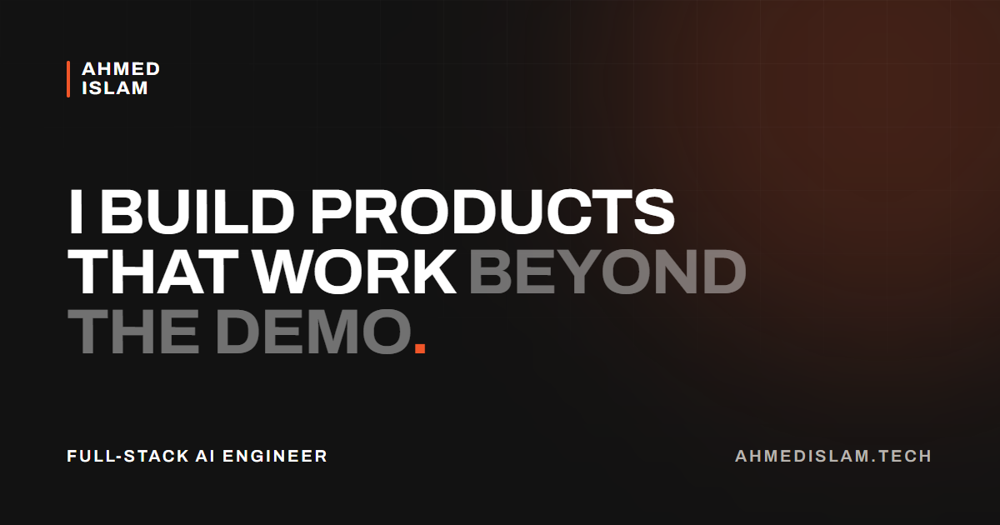
</a>

<h1>Ahmed Islam</h1>

<p><strong>Full-Stack AI Engineer</strong> · Islamabad, Pakistan</p>

<p>
I build production AI systems and the full-stack products around them:<br>
LangGraph, MCP and RAG on the back end, React and Next.js on the front.
</p>

<p>
  <a href="https://ahmedislam.tech"><strong>ahmedislam.tech</strong></a>
  &nbsp;·&nbsp;
  <a href="public/Ahmed-Islam-CV.pdf">Download CV</a>
  &nbsp;·&nbsp;
  <a href="mailto:hello@ahmedislam.tech">hello@ahmedislam.tech</a>
</p>

<p>
  <a href="https://wa.me/923008760724" title="WhatsApp"></a>&nbsp;&nbsp;&nbsp;
  <a href="https://www.linkedin.com/in/ahmed-islam-ai/" title="LinkedIn"></a>&nbsp;&nbsp;&nbsp;
  <a href="https://github.com/Ahmed-Islam-AI" title="GitHub"></a>&nbsp;&nbsp;&nbsp;
  <a href="https://www.upwork.com/freelancers/~013d744c3e6673db44" title="Upwork"></a>&nbsp;&nbsp;&nbsp;
  <a href="https://ahmed-islam.medium.com/" title="Medium"></a>&nbsp;&nbsp;&nbsp;
  <a href="https://leetcode.com/u/user9234eM/" title="LeetCode"></a>&nbsp;&nbsp;&nbsp;
  <a href="https://x.com/DevAhmedAI" title="X"></a>&nbsp;&nbsp;&nbsp;
  <a href="https://www.instagram.com/ahmedislam.ai" title="Instagram"></a>&nbsp;&nbsp;&nbsp;
  <a href="https://facebook.com/AhmedIslamAI" title="Facebook"></a>
</p>

</div>

<br>

## The site

This repository is the source of [ahmedislam.tech](https://ahmedislam.tech): my portfolio, a page for each service I offer, and a technical blog.

<table>
  <tr>
    <td width="74%" valign="top">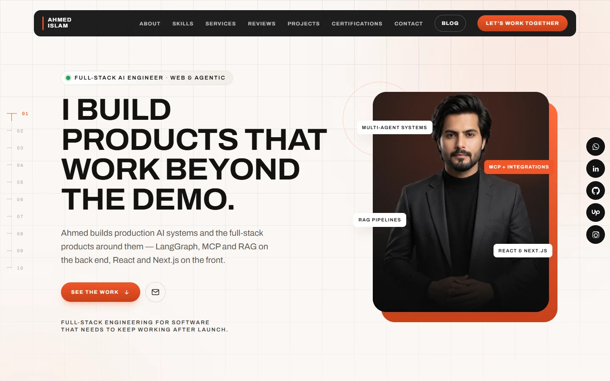</td>
    <td width="26%" valign="top">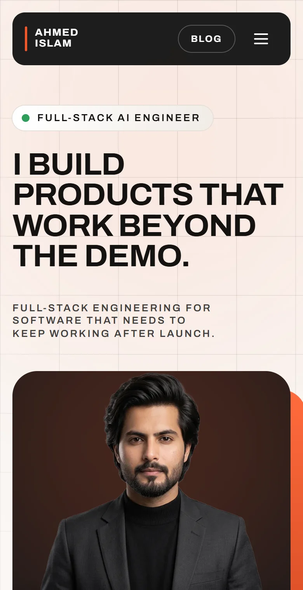</td>
  </tr>
  <tr>
    <td align="center"><sub>Home page</sub></td>
    <td align="center"><sub>On a phone</sub></td>
  </tr>
</table>

<table>
  <tr>
    <td width="50%" valign="top">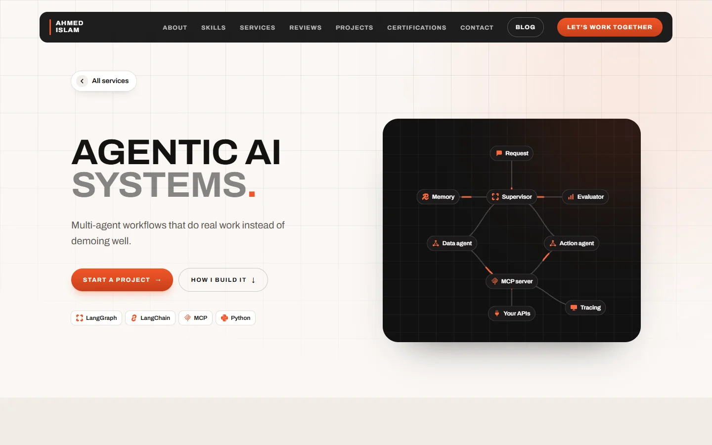</td>
    <td width="50%" valign="top">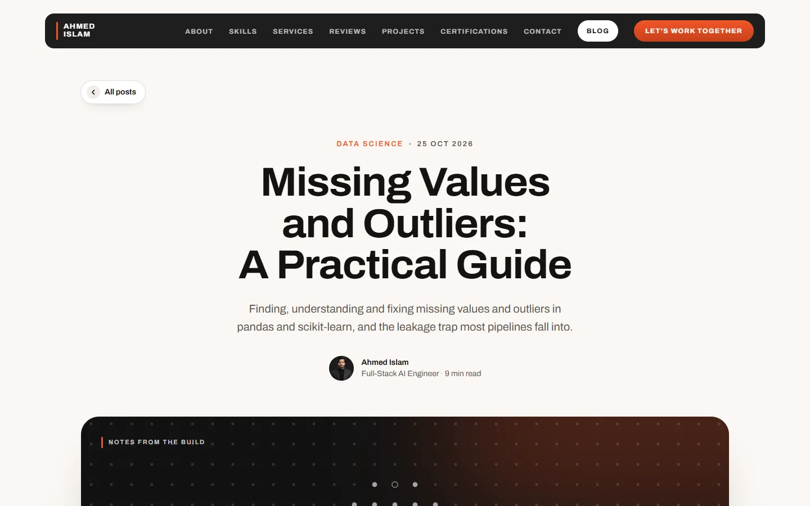</td>
  </tr>
  <tr>
    <td align="center"><sub>A service page</sub></td>
    <td align="center"><sub>The blog</sub></td>
  </tr>
</table>

## Projects

Ten projects, from an assistant inside a live SaaS platform to an Android app that works offline. Each one links to the product or to its source code.

<table>
  <tr>
    <td width="50%" valign="top">
      <a href="https://www.padelos.co/">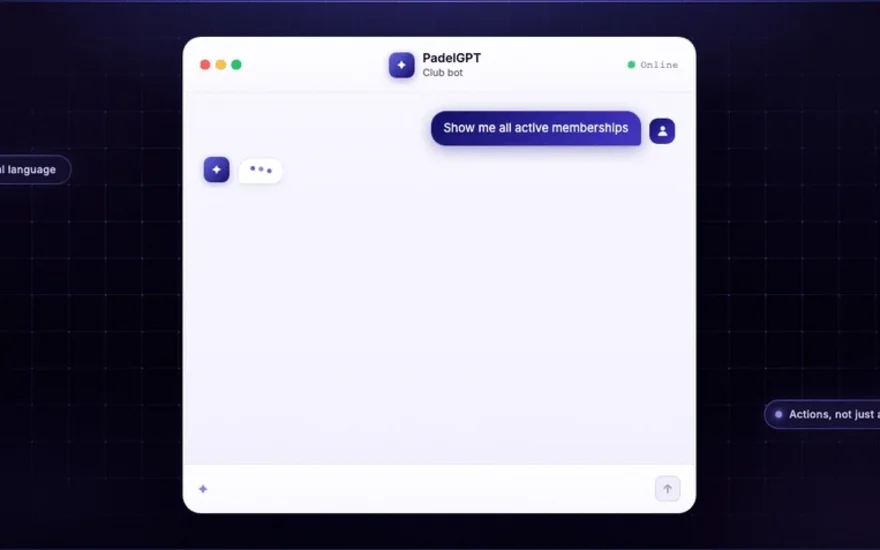</a>
      <h3><a href="https://www.padelos.co/">PadelGPT</a></h3>
      <sub><b>LIVE</b> · padelos.co</sub>
      <p>Platform assistant for the Padelos SaaS. Answers in natural language and calls platform tools to act on club data, not just describe it.</p>
      <p><code>Python</code> <code>LangGraph</code> <code>LangChain</code> <code>MCP</code> <code>FAISS</code> <code>Redis</code></p>
    </td>
    <td width="50%" valign="top">
      <a href="https://github.com/Ahmed-Islam-AI/Dukaan-Inventory/releases/latest">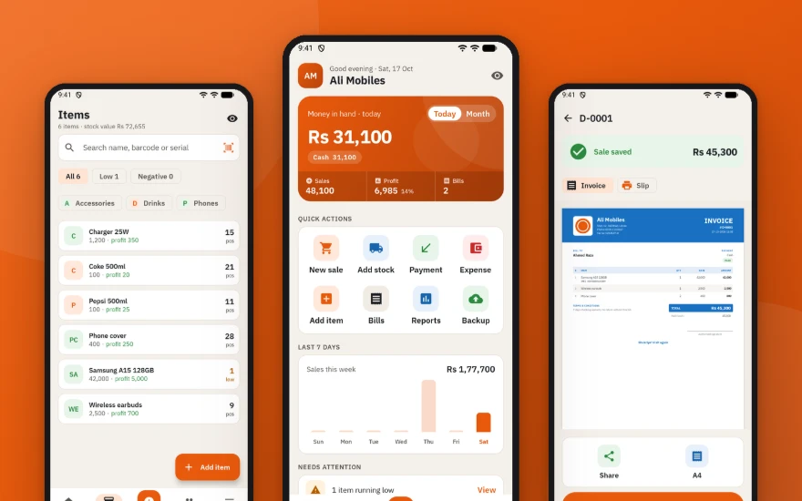</a>
      <h3><a href="https://github.com/Ahmed-Islam-AI/Dukaan-Inventory/releases/latest">Dukaan</a></h3>
      <sub><b>ANDROID APK</b> · Dukaan-Inventory</sub>
      <p>Billing, stock and udhaar (customer credit) for a small shop, in an Android app that works without internet. It shares invoices on WhatsApp and runs in English or Urdu.</p>
      <p><code>Kotlin</code> <code>Jetpack Compose</code> <code>SQLite</code> <code>Firebase</code> <code>ML Kit</code></p>
    </td>
  </tr>
  <tr>
    <td width="50%" valign="top">
      <a href="https://github.com/Ahmed-Islam-AI/Flint-Grab-site">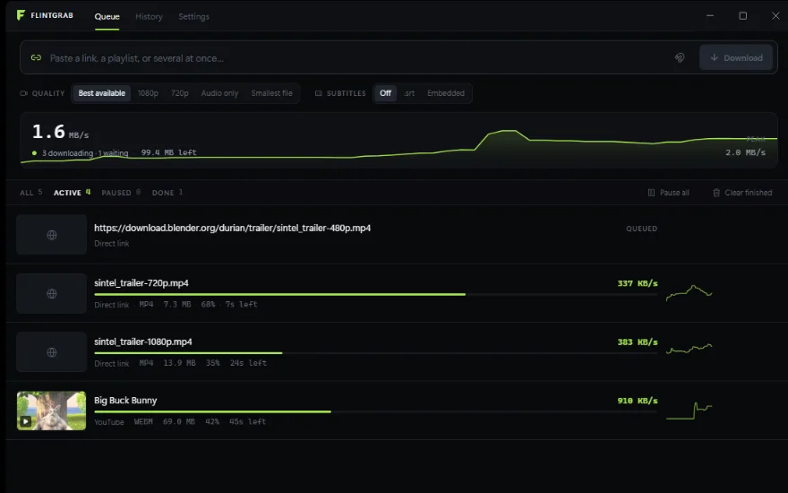</a>
      <h3><a href="https://github.com/Ahmed-Islam-AI/Flint-Grab-site">Flintgrab</a></h3>
      <sub><b>SOURCE</b> · Flint-Grab-site</sub>
      <p>A Windows download manager for social video, which arrives as streaming manifests rather than files. Segmented transfers, pause and resume, and a browser extension that hands off the page session.</p>
      <p><code>Electron</code> <code>React</code> <code>TypeScript</code> <code>Tailwind CSS</code> <code>SQLite</code> <code>WebTorrent</code></p>
    </td>
    <td width="50%" valign="top">
      <a href="https://www.padelos.co/">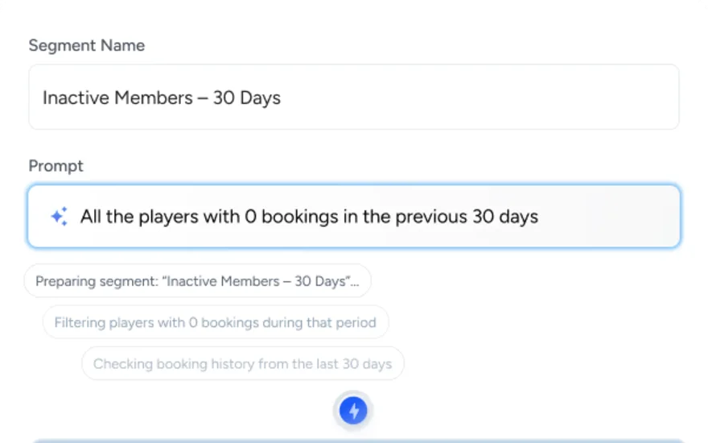</a>
      <h3><a href="https://www.padelos.co/">Player Segmentation</a></h3>
      <sub><b>LIVE</b> · padelos.co</sub>
      <p>Natural-language player segmentation for the Padelos platform. Describe a segment in plain English and it resolves the filter against real booking and spending history.</p>
      <p><code>Python</code> <code>LangGraph</code> <code>LangChain</code> <code>Redis</code></p>
    </td>
  </tr>
  <tr>
    <td width="50%" valign="top">
      <a href="https://github.com/Ahmed-Islam-AI/PPE-Detection-for-Construction-site-workers"></a>
      <h3><a href="https://github.com/Ahmed-Islam-AI/PPE-Detection-for-Construction-site-workers">Construction Safety System</a></h3>
      <sub><b>SOURCE</b> · PPE-Detection-for-Construction-site-workers</sub>
      <p>Safety monitoring for construction sites: YOLOv8 PPE detection, facial-recognition attendance, and an Arduino/ROS unit that patrols autonomously.</p>
      <p><code>Python</code> <code>YOLO</code> <code>OpenCV</code> <code>Flask</code> <code>SQLite</code> <code>Arduino</code> <code>ROS</code></p>
    </td>
    <td width="50%" valign="top">
      <a href="https://github.com/Ahmed-Islam-AI/Itsolera-Internship/tree/main/Content%20Moderation%20Project%201">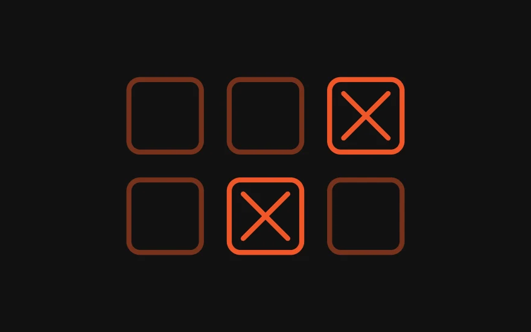</a>
      <h3><a href="https://github.com/Ahmed-Islam-AI/Itsolera-Internship/tree/main/Content%20Moderation%20Project%201">Content Moderation System</a></h3>
      <sub><b>SOURCE</b> · 92% image / 90% text accuracy</sub>
      <p>Detects and filters inappropriate content in both text and images: an NLP model for text, a CNN with transfer learning for images.</p>
      <p><code>Python</code> <code>NLP</code> <code>CNNs</code> <code>Transfer Learning</code> <code>Streamlit</code></p>
    </td>
  </tr>
  <tr>
    <td width="50%" valign="top">
      <a href="https://github.com/Ahmed-Islam-AI/web-sockets-implementation"></a>
      <h3><a href="https://github.com/Ahmed-Islam-AI/web-sockets-implementation">Real-time Audio Streaming</a></h3>
      <sub><b>SOURCE</b> · web-sockets-implementation</sub>
      <p>Two-way audio communication over the web, streaming audio between clients through a WebSocket server.</p>
      <p><code>Python</code> <code>WebSockets</code> <code>Flask</code></p>
    </td>
    <td width="50%" valign="top">
      <a href="https://github.com/Ahmed-Islam-AI/Smog-Classification-Web-App">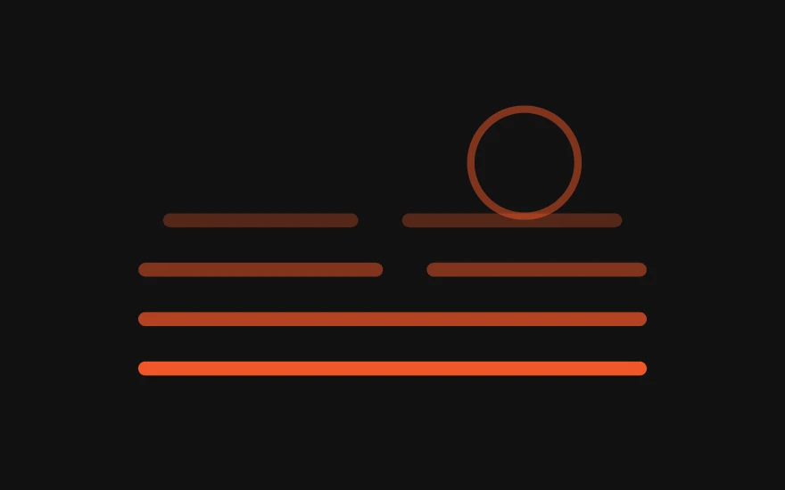</a>
      <h3><a href="https://github.com/Ahmed-Islam-AI/Smog-Classification-Web-App">Smog & Weather Analysis</a></h3>
      <sub><b>SOURCE</b> · Smog-Classification-Web-App</sub>
      <p>Upload an image to classify whether smog is present, or enter a city to pull its current weather conditions.</p>
      <p><code>Python</code> <code>TensorFlow</code> <code>CNNs</code> <code>Flask</code></p>
    </td>
  </tr>
  <tr>
    <td width="50%" valign="top">
      <a href="https://github.com/Ahmed-Islam-AI/Phishing-Url-detection-By-Using-ML">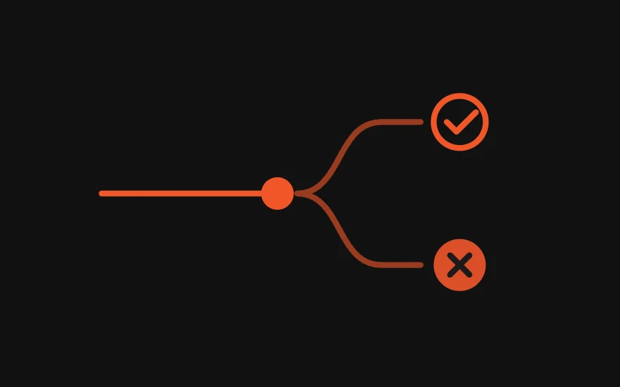</a>
      <h3><a href="https://github.com/Ahmed-Islam-AI/Phishing-Url-detection-By-Using-ML">Phishing URL Detector</a></h3>
      <sub><b>SOURCE</b> · Phishing-Url-detection-By-Using-ML</sub>
      <p>Classifies a URL as phishing or legitimate, so a user can be warned before the page loads.</p>
      <p><code>Python</code> <code>scikit-learn</code> <code>Streamlit</code></p>
    </td>
    <td width="50%" valign="top">
      <a href="https://github.com/Ahmed-Islam-AI/Web-Scrapper">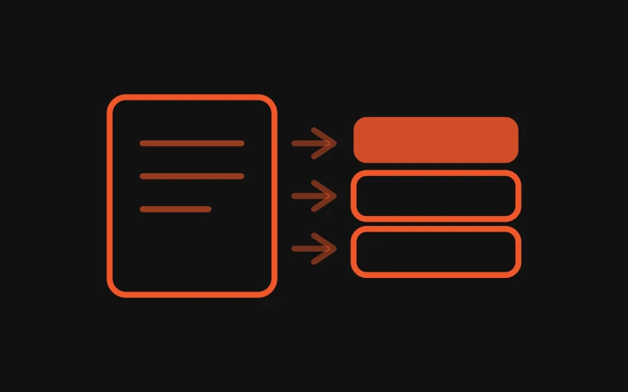</a>
      <h3><a href="https://github.com/Ahmed-Islam-AI/Web-Scrapper">E-commerce Data Scraper</a></h3>
      <sub><b>SOURCE</b> · Web-Scrapper</sub>
      <p>Scrapes product and pricing data from e-commerce and classifieds sites including eBay, Daraz and OLX.</p>
      <p><code>Python</code> <code>Selenium</code> <code>BeautifulSoup</code> <code>Web scraping</code></p>
    </td>
  </tr>
</table>

## Experience

| Role | Company | Dates |
| --- | --- | --- |
| Associate AI Engineer | Padelos | Jan 2026 – Present |
| Junior AI Engineer | IR Solutions | Jul 2025 – Dec 2025 |
| Deep Learning Intern | Itsolera | Jul 2024 – Oct 2024 |
| Machine Learning Fellow | Bytewise | Jun 2024 – Sep 2024 |

**Education:** BS Computer Science, University of Haripur (2021 – 2025), CGPA 3.79 / 4.0.

The full details are in the [CV](public/Ahmed-Islam-CV.pdf).

## What I work on

Each service has its own page on the site, with how I build it and the questions clients usually ask.

| Service | What it covers |
| --- | --- |
| [Agentic AI systems](https://ahmedislam.tech/services/agentic-ai) | Multi-agent workflows, tool calling, MCP servers |
| [RAG & knowledge systems](https://ahmedislam.tech/services/rag-development) | Answers grounded in your own documents |
| [Web apps & websites](https://ahmedislam.tech/services/web-development) | React and Next.js sites and apps |
| [Full-stack AI products](https://ahmedislam.tech/services/full-stack-ai) | The backend, the data and the interface around a model |
| [Automation & data pipelines](https://ahmedislam.tech/services/automation) | n8n workflows, scraping, ETL |
| [ML & computer vision](https://ahmedislam.tech/services/machine-learning) | Training, evaluating and deploying models |
| [Deployment & observability](https://ahmedislam.tech/services/ai-deployment) | Docker, cloud deploys, tracing with Langfuse and OpenTelemetry |

## Skills

| Area | Tools |
| --- | --- |
| LLM & agentic AI | LangChain, LangGraph, MCP, RAG, tool calling, multi-agent orchestration, prompt engineering, fine-tuning, OpenAI, Anthropic Claude, Google Gemini, LLaMA, Mistral, Ollama, Hugging Face, Groq |
| ML & deep learning | scikit-learn, TensorFlow, PyTorch, CNNs, U-Net, YOLO, NLP, computer vision, transfer learning |
| Data & backend | FastAPI, Flask, FastMCP, ETL / ELT pipelines, n8n, REST APIs, Socket.io, pandas |
| Front-end | React, Next.js, HTML, CSS, Tailwind CSS, Bootstrap |
| Cloud & DevOps | AWS EC2, CloudWatch, Azure App Service, Google Cloud, Docker, Kubernetes, Bitbucket Pipelines, Vercel, Netlify, OpenTelemetry, Langfuse |
| Data stores | FAISS, ChromaDB, Redis, PostgreSQL, MySQL, SQLite, MongoDB, Firebase |
| Languages | Python, SQL, JavaScript, C++ |

<details>
<summary><b>Certifications (11)</b></summary>
<br>

| Certification | Issuer |
| --- | --- |
| Introduction to LangGraph | LangChain Academy |
| LangChain for LLM App Development | DeepLearning.AI |
| Deep Learning Specialization | DeepLearning.AI · Coursera |
| Machine Learning Specialization | DeepLearning.AI · Coursera |
| TensorFlow Developer Certificate | TensorFlow · Google |
| Python for Data Science, AI & Development | IBM · Coursera |
| IBM Certified Machine Learning | IBM |
| AWS Educate: Introduction to Cloud 101 | Amazon Web Services (AWS) |
| MLOps Course | Udemy |
| Data Science & AI Bootcamp | Atomcamp |
| AI & Machine Learning Foundation | Xeven Solutions |

</details>

## Get in touch

The fastest way to reach me is the [contact form](https://ahmedislam.tech/#contact) on the site, WhatsApp or email.

| Platform | Profile |
| --- | --- |
| &nbsp; WhatsApp | [+92 300 8760724](https://wa.me/923008760724) |
| &nbsp; LinkedIn | [ahmed-islam-ai](https://www.linkedin.com/in/ahmed-islam-ai/) |
| &nbsp; GitHub | [Ahmed-Islam-AI](https://github.com/Ahmed-Islam-AI) |
| &nbsp; Upwork | [Ahmed Islam](https://www.upwork.com/freelancers/~013d744c3e6673db44) |
| &nbsp; Medium | [@ahmed-islam](https://ahmed-islam.medium.com/) |
| &nbsp; LeetCode | [user9234eM](https://leetcode.com/u/user9234eM/) |
| &nbsp; X | [@DevAhmedAI](https://x.com/DevAhmedAI) |
| &nbsp; Instagram | [@ahmedislam.ai](https://www.instagram.com/ahmedislam.ai) |
| &nbsp; Facebook | [AhmedIslamAI](https://facebook.com/AhmedIslamAI) |

---

## How this site is built

| Layer | Choice |
| --- | --- |
| Build | Vite 8 |
| UI | React 19, TypeScript (strict) |
| Styling | Tailwind CSS 4. Design tokens live in `src/index.css`; there is no config file |
| Routing | React Router 7 |
| Hosting | GitHub Pages, deployed by GitHub Actions on every push to `main` |

- **Every page is prerendered.** The build renders each route to HTML, then React hydrates it in the browser. Search engines and link previews read the full text without running JavaScript.
- **The blog is Markdown.** Posts in `src/content/blog/` compile at build time, code highlighting included, so no Markdown or highlighting library reaches the browser.
- **One page per service**, each with its own title, description, structured data and sitemap entry.
- **No animation library.** Motion uses IntersectionObserver, CSS scroll timelines and small `requestAnimationFrame` loops, and all of it respects reduced-motion settings.
- **Privacy-aware analytics.** Google Analytics 4 with Consent Mode v2, and a consent banner for visitors in Europe. The font is self-hosted, so no request goes to Google Fonts.

### Run it locally

```bash
npm install
npm run dev        # http://localhost:5173
npm run build      # type-check, build, and prerender every page into dist/
npx vite preview   # serve the production build
```

### Write a blog post

1. Create `src/content/blog/<slug>.md`. The file name is the URL.
2. Start it with frontmatter:
   ```
   ---
   title: Post title
   description: One sentence, used for the share card and the blog index.
   date: 2026-11-12
   tags: [Data Science, pandas]
   draft: true
   ---
   ```
   `draft: true` shows the post in `npm run dev` and leaves it out of the build.
3. Write Markdown. Put images in `public/blog-images/<slug>/`.
4. Push to `main`.

### Where things are

```
src/
  pages/          Home, /projects, /blog, /blog/:slug, /services/:id, /privacy
  components/     one file per section (Hero, Work, Stack, Services, Method, Projects, ...)
  data/           projects, services, certifications, testimonials, social links
  content/blog/   the blog posts
  index.css       design tokens and global styles
public/           CV, project images, fonts, share image
blog.vite.ts      compiles the blog, writes per-page HTML and the sitemap
prerender.mjs     fills each built page with its rendered HTML
```

[`STYLE.md`](STYLE.md) is the design system and [`CLAUDE.md`](CLAUDE.md) holds the engineering notes.

## License

The code is released under the [MIT License](LICENSE). The Archivo typeface is used under the [SIL Open Font License](public/fonts/OFL.txt), and brand icons come from [Simple Icons](https://simpleicons.org) (CC0).
